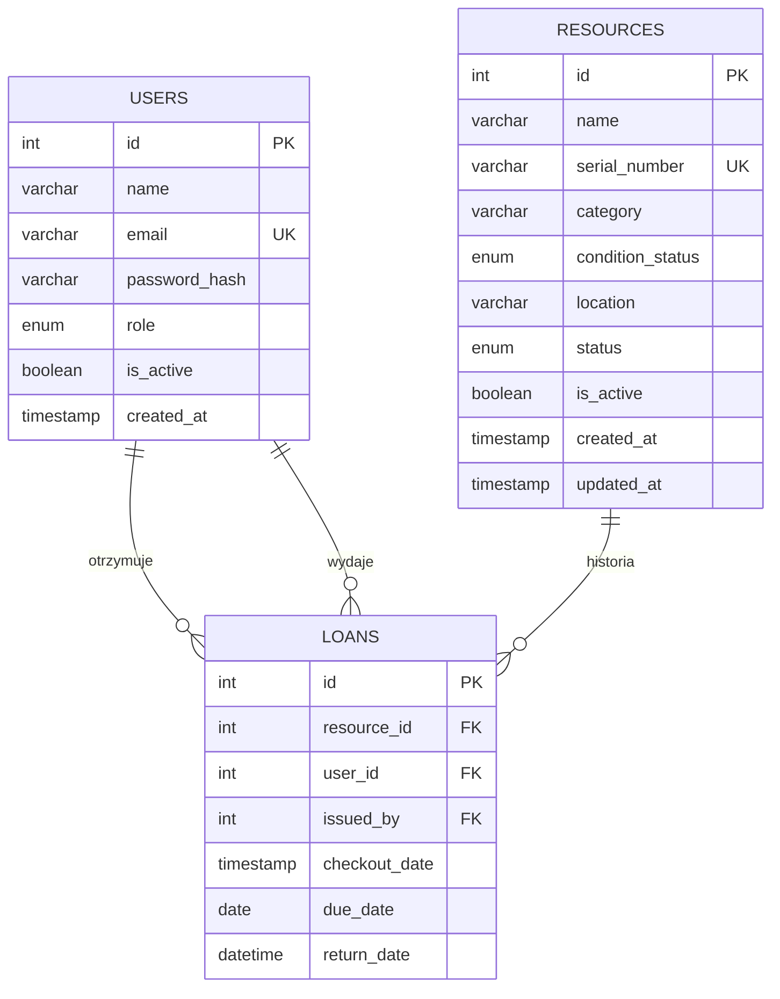

# Model bazy danych — ERD

## Diagram

## Opis
- Jeden użytkownik może mieć wiele wypożyczeń; wypożyczenie wskazuje jednego użytkownika przez user_id.
- Administrator wydający zasób jest zapisany przez issued_by.
- Zasób może mieć wiele wpisów historii w różnym czasie, ale tylko jedno aktywne wypożyczenie naraz.
- return_date = NULL oznacza wypożyczenie aktywne.
- Usunięcie w aplikacji oznacza archiwizację przez is_active = 0, aby zachować historię.

Nazwy tabel i pól odpowiadają database/schema.sql.